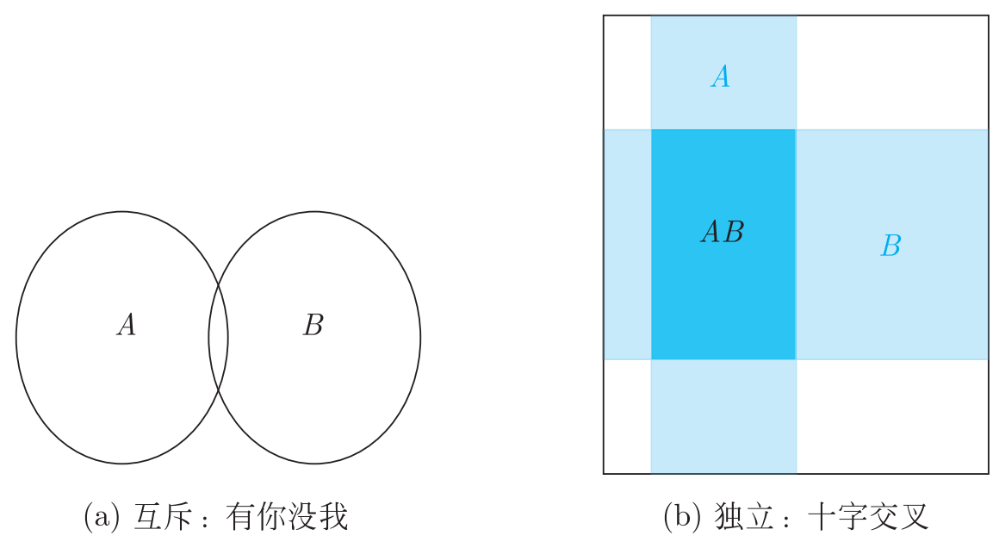
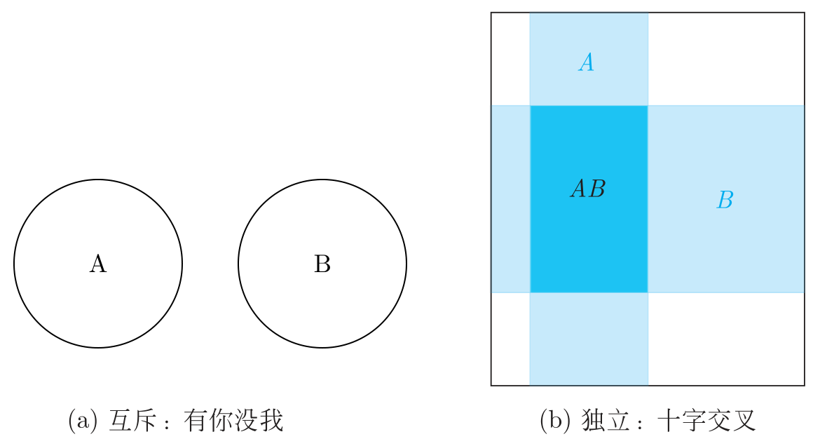
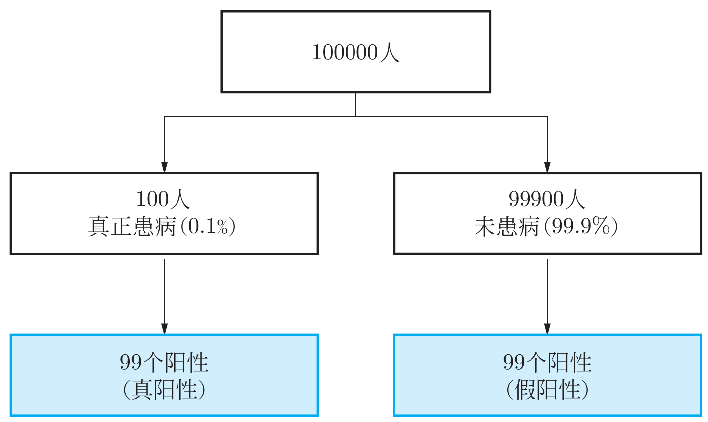
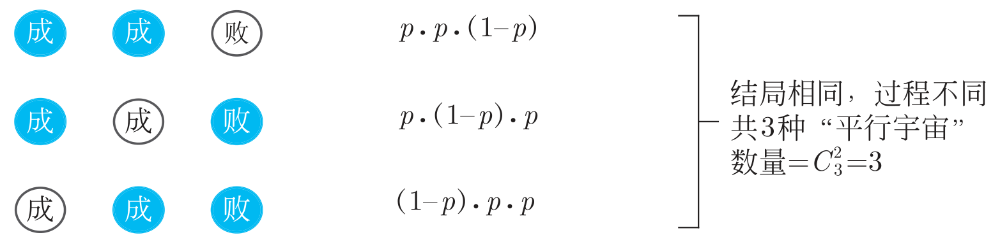
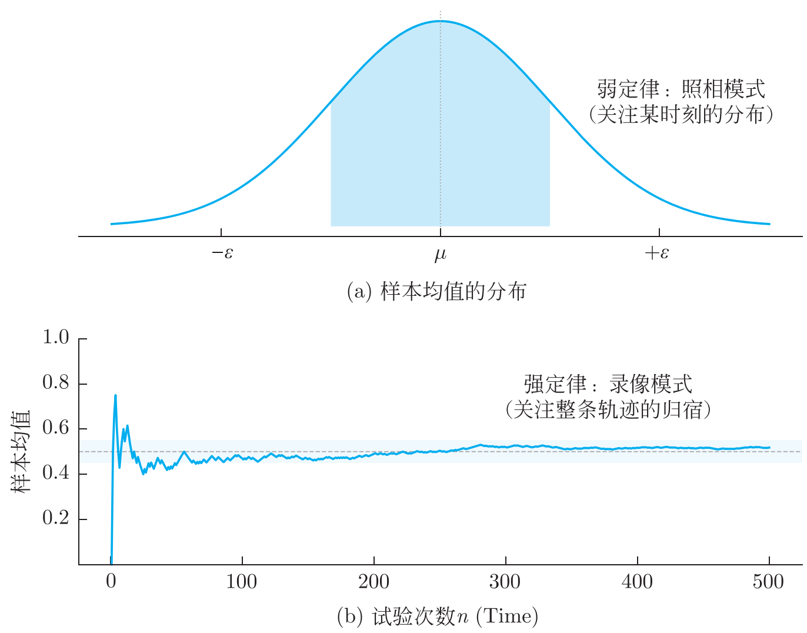
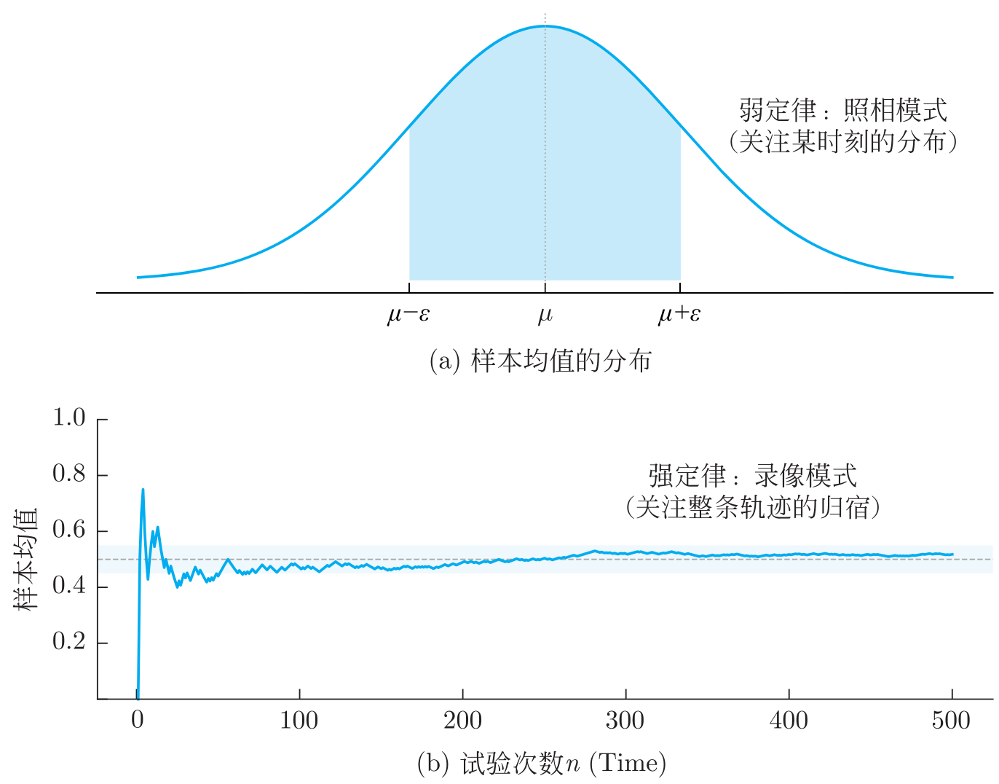
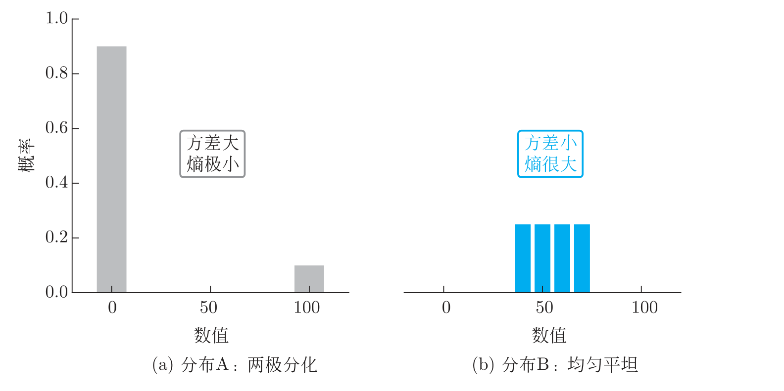
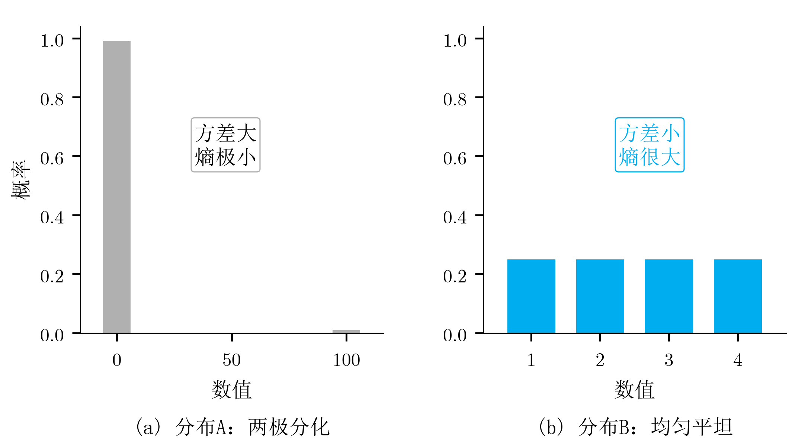
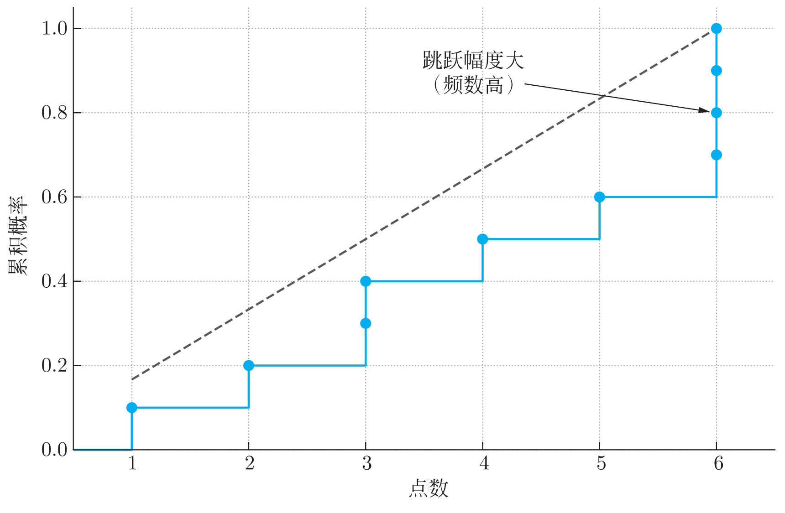

# 《大白话概率论》公开勘误完整版

共13组勘误。各条按首个书内印刷页码排序，图误附原图与修正版。

## 1 第63页 互斥事件示意图

**原印刷：**图3-3(a)用两个圆表示互斥事件，图中的 A、B 两圆画出了交叠区域。

**修改为：**图3-3(a)中的 A、B 两圆分开，彼此没有交叠区域。

**原印刷图**



**修正版**



## 2 第78页 假阳性人数

**原印刷：**图3-7右下角标为“99个阳性（假阳性）”。

**更正：**应为“999个阳性（假阳性）”。

健康者共有99,900人，假阳性率为1%，所以：

```math
99,900 \times 1\mathit{\%} = 999.
```

左下角的真阳性人数仍为99人。总阳性人数为$`99 + 999 = 1098`$人，阳性者中实际患病的比例约为$`99/1098 \approx 9\mathit{\%}`$。正文这部分计算正确，只需更正图中的假阳性人数。

**原印刷图**



**修正版**


## 3 第217页 三种成功序列

**原印刷：**图6-4中，第二行圆内文字误写为“成、成、败”，第三行误写为“败、成、败”。

**更正：**从上到下应分别为：

| **第1次** | **第2次** | **第3次** |
|:---------:|:---------:|:---------:|
|    成     |    成     |    败     |
|    成     |    败     |    成     |
|    败     |    成     |    成     |

三次试验恰好成功两次，共有$`\binom{3}{2} = 3`$种不同序列；图中应分别画出这三种情况。

**原印刷图**



**修正版**


## 4 第225页 泊松分布的类型

**原印刷：**“离散的二项分布就平滑地过渡到了连续的泊松分布。”

**更正：**删除“连续的”，改为“离散的二项分布就平滑地过渡到了泊松分布”。

泊松分布描述的是发生次数，取值为$`0,1,2,\mathit{\ldots}`$，属于离散型分布。

## 5 第403页 独立性与联合分布

**位置：**第9.1节“联合分布：看清全貌的合照”，页面中部“AI视野”蓝框内。

**原印刷：**如果这些像素相互独立（没有联合分布），你生成的只能是电视雪花屏（白噪声）。

**修改为：**如果这些像素相互独立（没有相互依赖），你生成的只能是电视雪花屏（白噪声）。

独立的变量也有联合分布；独立时，联合分布可以由各自的边缘分布相乘得到。

## 6 第525页 弱大数定律示意图的刻度

**原印刷：**图12-6(a)横轴上的两个刻度标为「−ε」和「+ε」，刻度线落在阴影带之外。

**修改为：**左、右刻度分别改标「μ−ε」和「μ+ε」，并移到阴影带的左右边界。

**原印刷图**



**修正版**



## 7 第573页 输光概率减少量的减法方向

设$`\mathit{P}(\mathit{a})`$表示拥有$`\mathit{a}`$元时最终输光的概率。

**原印刷：**

- 从$`\mathit{a} - 1`$元增加到$`\mathit{a}`$元，概率减少量写为$`\mathit{P}(\mathit{a}) - \mathit{P}(\mathit{a} - 1)`$。

- 从$`\mathit{a}`$元增加到$`\mathit{a} + 1`$元，概率减少量写为$`\mathit{P}(\mathit{a} + 1) - \mathit{P}(\mathit{a})`$。

**更正：**

- 从$`\mathit{a} - 1`$元增加到$`\mathit{a}`$元，减少量为$`\mathit{P}(\mathit{a} - 1) - \mathit{P}(\mathit{a})`$。

- 从$`\mathit{a}`$元增加到$`\mathit{a} + 1`$元，减少量为$`\mathit{P}(\mathit{a}) - \mathit{P}(\mathit{a} + 1)`$。

“减少了多少”应当用原来的值减去新的值。例如，风险从60%降到50%，减少量为$`60\mathit{\%} - 50\mathit{\%} = 10`$个百分点。

式（14-2）本身正确，修正的是下方两处对“减少量”的解释。

## 8 第581页 猜数字时漏掉了4

**原印刷：**在1至8中猜数字时，问“大于4还是小于4？”

**更正：**应为“大于4还是小于等于4？”

原来的问法漏掉了数字4。修正后，两组分别是$`\{ 1,2,3,4\}`$和$`\{ 5,6,7,8\}`$，每组4个数。

## 9 第586页 分布图与正文数值不一致

**原印刷：**

- 图（a）两根柱高约为0.9和0.1。

- 图（b）四根等高柱位于40、50、60、70附近。

**更正：**

- 图（a）：$`\mathit{x} = 0`$处的概率为0.99，$`\mathit{x} = 100`$处的概率为0.01。

- 图（b）：取值为1、2、3、4，每个值的概率均为0.25。

按正文给定的分布，A的方差为99、熵约为0.08 bit；B的方差为1.25、熵为2 bit。正文这些数值可以保留，图应与正文对应。

**原印刷图**



**修正版**



## 10 第611页 理论分布函数与经验分布函数

**位置：**第16.1节“总体与样本：我们只能看到冰山一角”，页面下方图16-3。

### 图中两条分布函数

**原印刷：**图16-3的两条分布函数

**修改为：**理论分布函数：在$`\mathit{x} = 1,2,3,4,5,6`$处依次跳升$`\frac{1}{6}`$，每段水平并右连续。经验分布函数：删除竖直跳线中间的实心点$`(3,0.3)`$、$`(6,0.7)`$、$`(6,0.8)`$、$`(6,0.9)`$。

骰子的理论分布函数应为阶梯状；经验分布函数在每个取值处取跳跃后的累计频率。

**原印刷图**



**修正版**


## 11 第720页 同分布与随机变量相等

**位置：**第20.1节“2026年考研真题详细解答”，页面下半部第9题“思路与解答”中，两处分别以“这一步是解题的灵魂”和“这就看出来了”开头。

### 第一处 由分布函数关系解释变量关系

**原印刷：**这一步是解题的灵魂！这意味着事件 $`\{\mathit{Y} \leq \mathit{y}\}`$ 和事件 $`\{\mathit{X} \leq \mathit{ay} + \mathit{b}\}`$ 是同一回事。我们稍微变换一下不等式（注意题目隐含$`\mathit{a} > 0`$，因为 $`\mathit{\sigma} > 0`$ 且选项都是正数，否则不等号要变向）。

**修改为：**这一步是解题的灵魂！它说明的是 $`\mathit{Y}`$ 与 $`\frac{\mathit{X} - \mathit{b}}{\mathit{a}}`$ 同分布。下面做个不等式变换（注意题目隐含 $`\mathit{a} > 0`$，因为 $`\mathit{\sigma} > 0`$ 且选项都是正数，否则不等号要变向）。

### 第二处 这就看出来了开头的一句

**原印刷：**这就看出来了，$`\mathit{Y}`$ 对应的就是 $`\frac{\mathit{X} - \mathit{b}}{\mathit{a}}`$。或者更舒服地写成：$`\mathit{X} = \mathit{aY} + \mathit{b}`$。

**修改为：**这就看出来了，$`\mathit{Y}`$ 与 $`\frac{\mathit{X} - \mathit{b}}{\mathit{a}}`$ 同分布。也就是说，$`\mathit{X}`$ 与 $`\mathit{aY} + \mathit{b}`$ 同分布。

题目给出的是分布关系，应表述为“同分布”。同分布变量的期望、方差相同，后面据此计算期望与方差的步骤保留。

## 12 第737页 概率密度需要补系数

**原印刷：**在$`0 < \mathit{x} < 1`$的范围内，用$`\mathit{x}^{2}`$举例作为概率密度。

**更正：**应将$`\mathit{x}^{2}`$改为$`3\mathit{x}^{2}`$，句中其余内容保留。

概率密度的积分应为1，而：

```math
\int_{0}^{1}{\mathit{x}^{2}\mathit{d}\mathit{x} = \frac{1}{3},\int_{0}^{1}{3\mathit{x}^{2}\mathit{d}\mathit{x} = 1.}}
```

## 13 第751页 翻转牌序时第一张与最后一张的对应

**原印刷：**“随机排列下，正序第一张黑桃与逆序第一张黑桃位置分布相同，因此期望位置之和为53。”

**更正：**原牌序中第一张与最后一张黑桃的期望位置之和为53。图20-7应表示“原序最后一张黑桃，翻转后成为逆序第一张黑桃”。

设原序第一张黑桃的位置为$`\mathit{F}`$，最后一张的位置为$`\mathit{L}`$，逆序第一张的位置为$`\mathit{R}`$。一副52张牌翻转后有：

```math
\mathit{R} = 53 - \mathit{L}.
```

随机排列下，$`\mathit{F}`$与$`\mathit{R}`$同分布，所以：

```math
\mathit{E}(\mathit{F}) = \mathit{E}(\mathit{R}) = 53 - \mathit{E}(\mathit{L}),\mathit{E}(\mathit{F}) + \mathit{E}(\mathit{L}) = 53.
```

本页上方已经写对的$`\mathit{E}(\mathit{F}) + \mathit{E}(\mathit{L}) = 53`$保留；修正的是后面的说明和图示。

**原印刷图**


**修正版**


