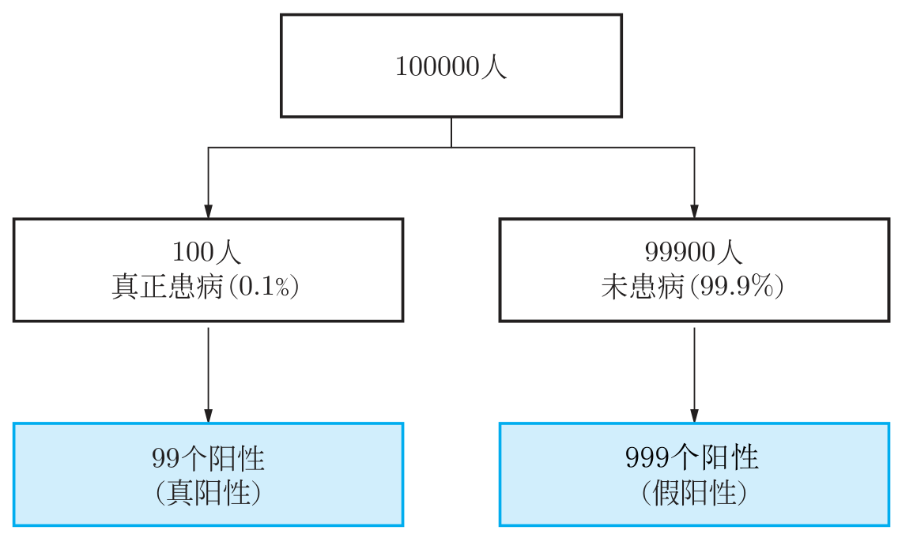
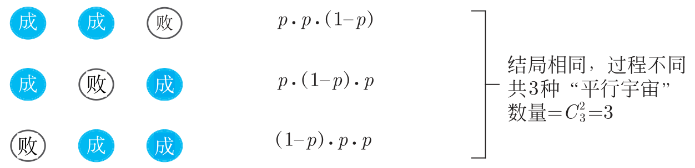
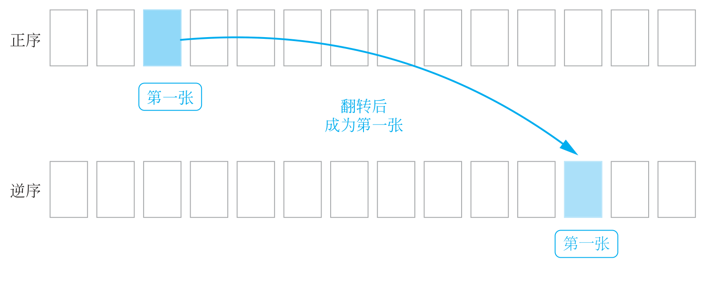
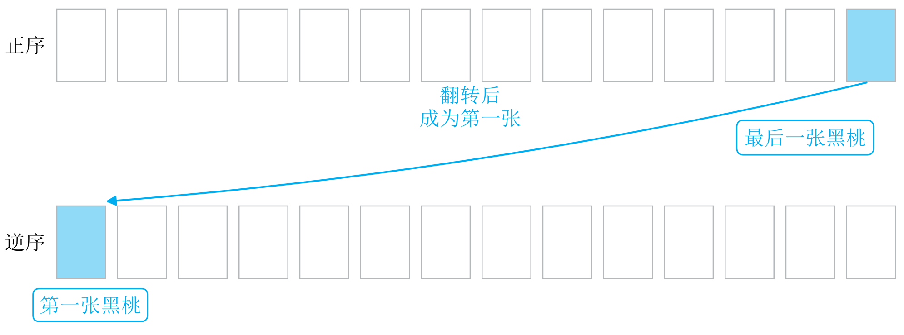
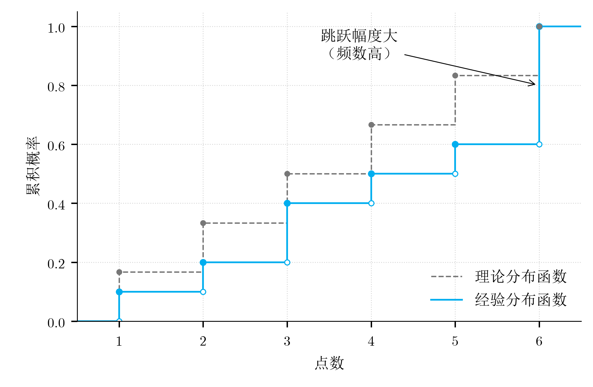

# 《大白话概率论》数学勘误

适用于：首次印刷本。印次可在图书版权页查看。

最后更新：2026年11月2日。

本页整理首印中影响理解的数学问题，页码均为书内印刷页码。同一问题涉及的多处改动合并说明。

## 1 第18页 事件总数的数量级

**页内位置：** 下方，“Python实验室”中的最后一段。

**所属节：** 2.1 样本空间和事件，具体为 2.1.7 Python实验室。

**原印刷：** 10枚硬币对应的理论事件总数为“$`10^{300}`$量级”。

**更正：** 应为“$`10^{308}`$量级”。

10枚硬币有$`2^{10}=1024`$种正反面排列，每个排列是一个样本点；事件是样本空间的子集，因此事件总数为：

```math
2^{1024}\approx1.7977\times10^{308}.
```

## 2 第78页 假阳性人数

**页内位置：** 中下方，图3-7的右下角。

**所属节：** 3.4 贝叶斯公式。

**原印刷：** 图3-7右下角标为“99个阳性（假阳性）”。

**更正：** 应为“999个阳性（假阳性）”。

健康者共有99,900人，假阳性率为1%，所以：

```math
99{,}900\times1\%=999.
```

左下角的真阳性人数仍为99人。总阳性人数为$`99+999=1098`$人，阳性者中实际患病的比例约为$`99/1098\approx9\%`$。正文这部分计算正确，只需更正图中的假阳性人数。

**原印刷图**


**修正版**



## 3 第217页 三种成功序列

**页内位置：** 上方，页首的图6-4。

**所属节：** 6.2 二项分布。

**原印刷：** 图6-4的三行圆内文字都写成了“成、成、败”。

**更正：** 从上到下应分别为：

| 第1次 | 第2次 | 第3次 |
|---|---|---|
| 成 | 成 | 败 |
| 成 | 败 | 成 |
| 败 | 成 | 成 |

三次试验恰好成功两次，共有$`\binom{3}{2}=3`$种不同序列；图中应分别画出这三种情况。

**原印刷图**


**修正版**



## 4 第217页 投篮次数的概率峰值

**页内位置：** 下方，接近最后一行。

**所属节：** 6.2 二项分布，具体为 6.2.3 理解分布的形状与参数。

**原印刷：** “例如$`p=0.9`$，投10次篮，命中8次或9次的概率最大。”

**更正：** 应为“命中9次的概率最大”。

设$`X\sim B(10,0.9)`$，则：

```math
P(X=8)\approx19.37\%,\qquad
P(X=9)\approx38.74\%,\qquad
P(X=10)\approx34.87\%.
```

最大值在9次，8次与9次并非并列最大。

## 5 第223至224页 时间片的单位

**页内位置：** 第223页下方，例6.4题干；第224页上方的第②问，以及下方“对比如下”中的“毫秒模型”。

**所属节：** 6.2 二项分布。

**原印刷：** 一分钟分成3600片时，称为“以毫秒为片”或“毫秒模型”。

**更正：** 应为“以$`1/60`$秒为片”或“$`1/60`$秒模型”。

```math
\frac{60\text{秒}}{3600}=\frac{1}{60}\text{秒}\approx16.67\text{毫秒}.
```

如果每片确实是1毫秒，一分钟应分成60,000片。

## 6 第225页 泊松分布的类型

**页内位置：** 上方，“通向极限的桥梁”这一条中。

**所属节：** 6.2 二项分布。

**原印刷：** “离散的二项分布就平滑地过渡到了连续的泊松分布。”

**更正：** 删除“连续的”，改为“离散的二项分布就平滑地过渡到了泊松分布”。

泊松分布描述的是发生次数，取值为$`0,1,2,\ldots`$，属于离散型分布。

## 7 第254至255页 超几何概率及相对误差

**页内位置：** 第254页下方，“场景乙”的精确概率公式；第255页上方的误差计算，以及中上方结论中的“0.017%”。

**所属节：** 6.4 超几何分布。

**原印刷：** 场景乙的精确概率约为0.34566，二项近似的相对误差约为0.017%。

**更正：** 精确概率约为0.3460327，相对误差约为0.125%。

```math
P_{\text{乙}}(X=2)
=\frac{\binom{800}{2}\binom{1200}{3}}{\binom{2000}{5}}
\approx0.3460327.
```

二项分布近似值为0.34560，因此：

```math
\text{相对误差}
=\frac{|0.34560-0.3460327|}{0.3460327}
\approx0.125\%.
```

第255页相关总结句中的0.017%也相应改为0.125%。

## 8 第573页 输光概率减少量的减法方向

**页内位置：** 中部，式（14-2）下方的两条项目符号说明。

**所属节：** 14.2 扩展：赌徒谬误与赌徒输光定理。

设$`P(a)`$表示拥有$`a`$元时最终输光的概率。

**原印刷：**

- 从$`a-1`$元增加到$`a`$元，概率减少量写为$`P(a)-P(a-1)`$。
- 从$`a`$元增加到$`a+1`$元，概率减少量写为$`P(a+1)-P(a)`$。

**更正：**

- 从$`a-1`$元增加到$`a`$元，减少量为$`P(a-1)-P(a)`$。
- 从$`a`$元增加到$`a+1`$元，减少量为$`P(a)-P(a+1)`$。

“减少了多少”应当用原来的值减去新的值。例如，风险从60%降到50%，减少量为$`60\%-50\%=10`$个百分点。

式（14-2）本身正确，修正的是下方两处对“减少量”的解释。

## 9 第581页 猜数字时漏掉了4

**页内位置：** 上方，“聪明人直接一刀切……”这句话。

**所属节：** 15.1 扩展：信息熵，具体为 15.1.4 比特：信息量的单位，以及为什么底数是2。

**原印刷：** 在1至8中猜数字时，问“大于4还是小于4？”

**更正：** 应为“大于4还是小于等于4？”

原来的问法漏掉了数字4。修正后，两组分别是$`\{1,2,3,4\}`$和$`\{5,6,7,8\}`$，每组4个数。

## 10 第586页 分布图与正文数值不一致

**页内位置：** 中下方，图15-4的两幅柱状图。

**所属节：** 15.1 扩展：信息熵。

**原印刷：**

- 图（a）两根柱高约为0.9和0.1。
- 图（b）四根等高柱位于40、50、60、70附近。

**更正：**

- 图（a）：$`x=0`$处的概率为0.99，$`x=100`$处的概率为0.01。
- 图（b）：取值为1、2、3、4，每个值的概率均为0.25。

按正文给定的分布，A的方差为99、熵约为0.08 bit；B的方差为1.25、熵为2 bit。正文这些数值可以保留，图应与正文对应。

**原印刷图**


**修正版**


## 11 第737页 概率密度需要补系数

**页内位置：** 上方，“但是，我要提醒大家……”这段中。

**所属节：** 20.3 2024年考研真题详细解答。

**原印刷：** 在$`0<x<1`$的范围内，用$`x^2`$举例作为概率密度。

**更正：** 应将$`x^2`$改为$`3x^2`$，句中其余内容保留。

概率密度的积分应为1，而：

```math
\int_0^1 x^2\,dx=\frac13,\qquad
\int_0^1 3x^2\,dx=1.
```

## 12 第751页 翻转牌序时第一张与最后一张的对应

**页内位置：** 上方文字中“随机排列下……”那句话，以及中部的图20-7。

**所属节：** 20.4 彩蛋：大厂算法岗面试桌上的概率题。

**原印刷：** “随机排列下，正序第一张黑桃与逆序第一张黑桃位置分布相同，因此期望位置之和为53。”

**更正：** 原牌序中第一张与最后一张黑桃的期望位置之和为53。图20-7应表示“原序最后一张黑桃，翻转后成为逆序第一张黑桃”。

设原序第一张黑桃的位置为$`F`$，最后一张的位置为$`L`$，逆序第一张的位置为$`R`$。一副52张牌翻转后有：

```math
R=53-L.
```

随机排列下，$`F`$与$`R`$同分布，所以：

```math
E(F)=E(R)=53-E(L),
\qquad E(F)+E(L)=53.
```

本页上方已经写对的$`E(F)+E(L)=53`$保留；修正的是后面的说明和图示。

**原印刷图**



**修正版**



## 13 第403页 独立性与联合分布

**页内位置：** 页面中部“AI视野”蓝框内。

**所属节：** 9.1 联合分布：看清全貌的合照。

**原印刷：** 如果这些像素相互独立（没有联合分布），你生成的只能是电视雪花屏（白噪声）。

**修改为：** 如果这些像素相互独立（没有相互依赖），你生成的只能是电视雪花屏（白噪声）。

独立的变量也有联合分布；独立时，联合分布可以由各自的边缘分布相乘得到。

## 14 第520至521页及第545页 大数定律

**页内位置：** 第520页两处蓝框及页面下方总结段；第521页综合判断例题第2问的解答；第545页下方“学习目标”第3项。

**所属节：** 第520、521页为 12.1 大数定律：为什么平均值是可信的；第545页为 12.5 本章小结：重点与思考题。

### 第520页 第一处蓝框中辛钦定律一段的末句

**原印刷：** 这使得它成为适用范围最广、也最根本的结论，是统计推断中“用样本均值估计总体均值”这一根本操作的终极理论依据。

**修改为：** 这使得它成为适用范围最广的结论之一，是统计推断中“用样本均值估计总体均值”这一根本操作的理论依据。

### 第520页 第二处蓝框中切比雪夫定律的标题

**原印刷：** 切比雪夫定律条件中等

**修改为：** 切比雪夫定律允许不同分布

### 第520页 第二处蓝框中辛钦定律的标题

**原印刷：** 辛钦定律条件最弱

**修改为：** 辛钦定律不要求方差有限

### 第520页 页面下方以因此开头的总结段

**原印刷：** 因此，从伯努利到切比雪夫再到辛钦，是一个从特殊到一般、从技术演示到本质揭示的认知深化过程。辛钦大数定律以最弱的条件，成为支撑整个概率论与数理统计大厦最宽广的基石。

**修改为：** 因此，伯努利定律是切比雪夫和辛钦定律的特例；切比雪夫允许不同分布，辛钦不要求方差有限。两者放宽了不同条件，适用范围互不包含。

### 第521页 综合判断例题第2问的解答

**原印刷：** 切比雪夫定律的结论是样本均值依概率收敛于这个发散的$`\bar\mu_n`$，这没有固定目标，因此通常认为这种情况不满足我们关心的大数定律（即样本均值收敛于一个固定常数）。所以，$`\{Y_n\}`$不满足我们这里讨论的大数定律。

**修改为：** 切比雪夫定律的结论是样本均值与这个发散的$`\bar\mu_n`$之差依概率趋于0。所以，$`\{Y_n\}`$满足切比雪夫大数定律，只是样本均值不收敛于一个固定常数。

### 第545页 页面下方学习目标第3项中的表述

**原印刷：** 层次关系（谁是谁的特例，谁的条件最弱）

**修改为：** 联系与区别（谁是谁的特例，各自放宽了哪些条件）

切比雪夫定律允许不同分布，辛钦定律不要求方差有限，两者放宽的是不同条件。例12.5中的独立序列满足切比雪夫定律：需要考察样本均值与期望均值之差是否依概率趋于0。

## 15 第611页 理论分布函数与经验分布函数

**页内位置：** 页面下方，图16-3。

**所属节：** 16.1 总体与样本：我们只能看到冰山一角。

### 图中两条分布函数

**原印刷：** 图16-3的两条分布函数

**修改为：** 理论分布函数：在$`x=1,2,3,4,5,6`$处依次跳升$`\frac{1}{6}`$，每段水平并右连续。经验分布函数：删除竖直跳线中间的实心点$`(3,0.3)`$、$`(6,0.7)`$、$`(6,0.8)`$、$`(6,0.9)`$。

骰子的理论分布函数应为阶梯状；经验分布函数在每个取值处取跳跃后的累计频率。

**原印刷图**


**修正版**



## 16 第720页 同分布与随机变量相等

**页内位置：** 页面下半部，第9题“思路与解答”中，两处分别以“这一步是解题的灵魂”和“这就看出来了”开头。

**所属节：** 20.1 2026年考研真题详细解答。

### 第一处 由分布函数关系解释变量关系

**原印刷：** 这一步是解题的灵魂！这意味着事件 $`\{Y\le y\}`$ 和事件 $`\{X\le ay+b\}`$ 是同一回事。我们稍微变换一下不等式（注意题目隐含$`a>0`$，因为 $`\sigma>0`$ 且选项都是正数，否则不等号要变向）。

**修改为：** 这一步是解题的灵魂！它说明的是 $`Y`$ 与 $`\frac{X-b}{a}`$ 同分布。下面做个不等式变换（注意题目隐含 $`a>0`$，因为 $`\sigma>0`$ 且选项都是正数，否则不等号要变向）。

### 第二处 这就看出来了开头的一句

**原印刷：** 这就看出来了，$`Y`$ 对应的就是 $`\frac{X-b}{a}`$。或者更舒服地写成：$`X=aY+b`$。

**修改为：** 这就看出来了，$`Y`$ 与 $`\frac{X-b}{a}`$ 同分布。也就是说，$`X`$ 与 $`aY+b`$ 同分布。

题目给出的是分布关系，应表述为“同分布”。同分布变量的期望、方差相同，后面据此计算期望与方差的步骤保留。

